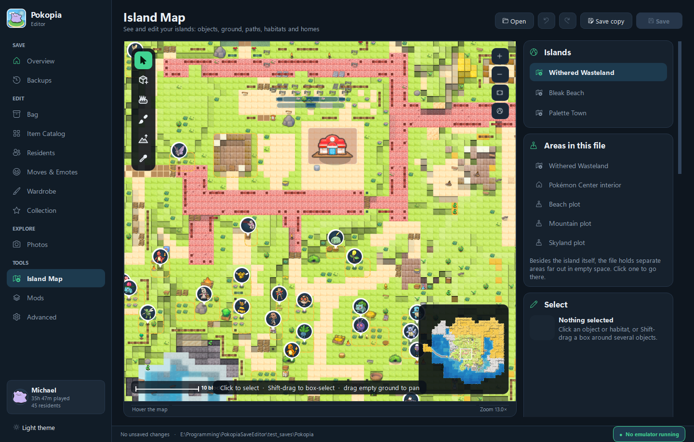
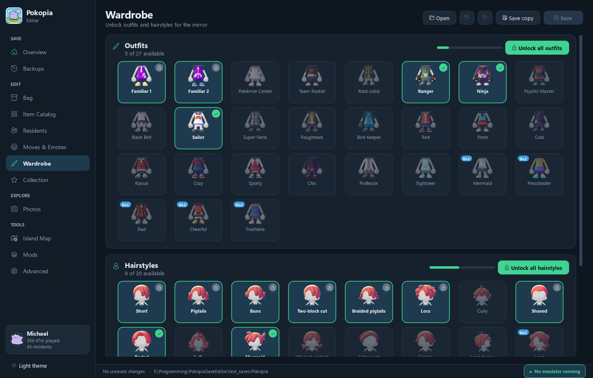
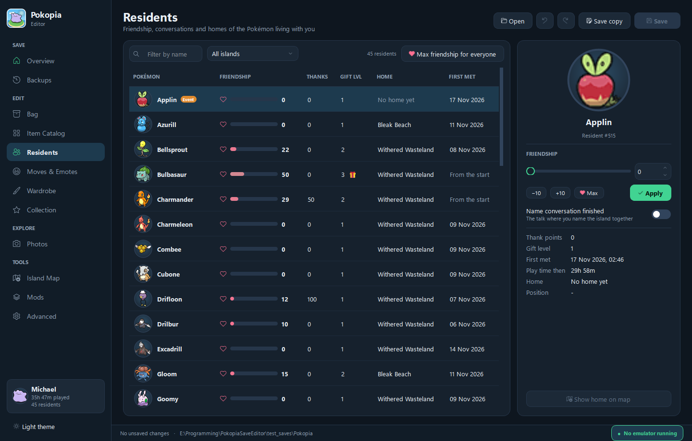
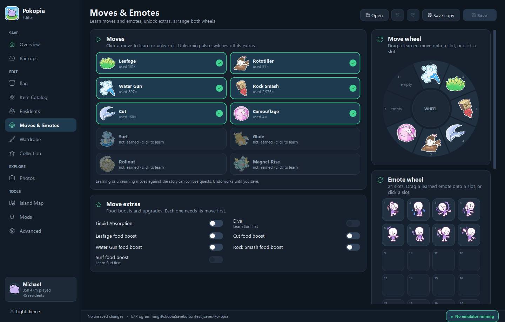
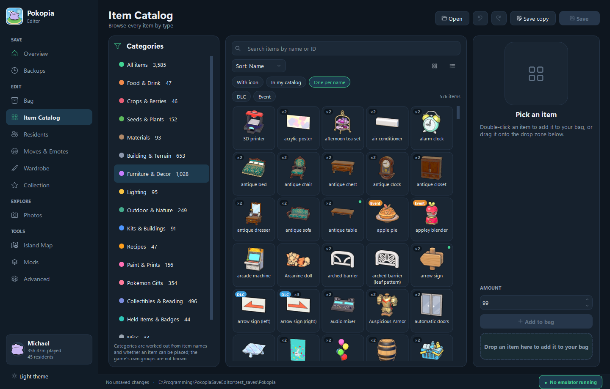
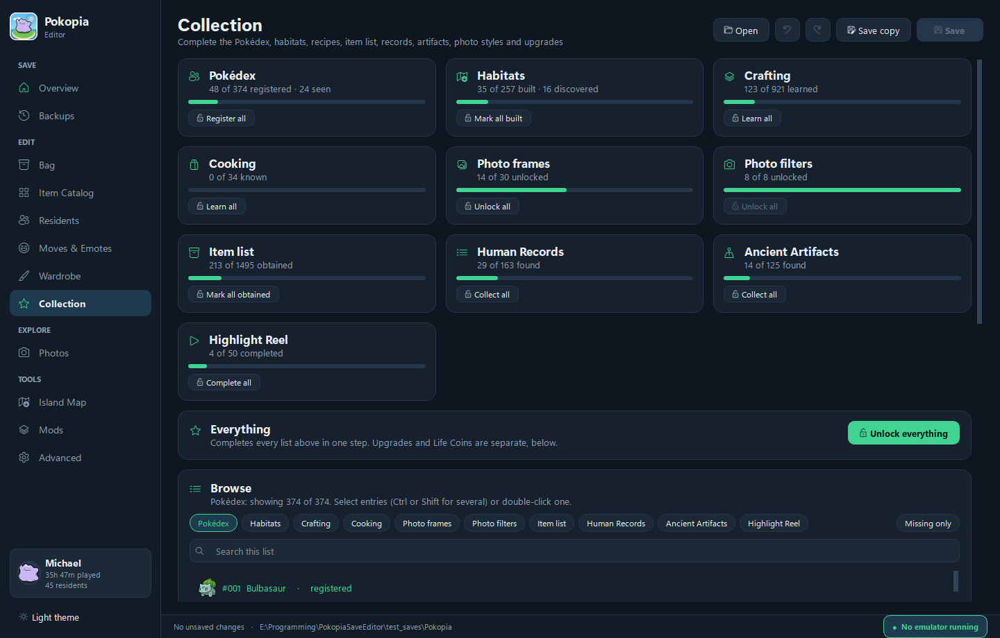

<div align="center">


# 🌿 Pokopia Editor RSH

**Build your island · Welcome new Pokémon · Make your Pokopia world your own**

A single-file Windows save editor with additional **Resident · Spawn · Habitat** tools.

<a href="https://github.com/Nymphikarosalpha/Pokopia-Editor-RSH/releases" title="Download Pokopia Editor RSH for Windows">
  
</a>

[](https://github.com/Nymphikarosalpha/Pokopia-Editor-RSH/releases)
[](CHANGELOG_FORK.md)
[](LICENSE)

**Windows 10 / 11** · **Pokopia 2.0.x save format** · **Development preview**

[🏡 Getting started](#getting-started) · [🎒 Features](#what-you-can-do) · [🌱 Spawn guide](#which-spawn-settings) · [🧩 Mods](#mods) · [🛡️ Save safety](#save-safety)




</div>

---

<a id="about-rsh"></a>
## 🌱 About Pokopia Editor RSH

**Pokopia Editor RSH** is a community fork of [cycalo/Pokopia-Editor](https://github.com/cycalo/Pokopia-Editor). It keeps the original save-editing pages, mods and credits while adding resident, habitat and *experimental* encounter controls.

> 🌼 **RSH = Resident · Spawn · Habitat.** The aim is to make editing your world easier while making experimental encounter behavior explicit — not to promise a Pokémon spawn that has not been verified.

### 🌿 What the RSH fork adds

| | RSH feature | What it does |
|:--:|---|---|
| 🏡 | **Resident Studio** | Add/update resident entries, friendship, first meeting and Pokédex registration |
| 💛 | **Home management** | Assign or unlink a habitat; experimentally remove a resident registry entry |
| 🌳 | **Habitat builder** | Select an island, place a supported recipe, or link an existing habitat |
| 📗 | **Offline habitat matching** | Resident-ID-based catalog with form-aware mappings and explicit manual overrides |
| 🎉 | **Event habitat tools** | Build supported E-series habitats or prepare event materials without claiming quest completion |
| ✨ | **Special encounter research** | Recognize Mew, Mewtwo and other special Pokémon; try ID−4 with an *existing* habitat as position anchor on supported stages |
| 🧭 | **In-editor recommendations** | See which mode fits the selected Pokémon and why a control may be unavailable |
| 🖥️ | **Lichii support** | Recognize Lichii and look for standard or nearby portable save folders |

The catalog covers **402 named resident records**: **350** mapped to buildable recipes, **17** explicitly without a buildable normal habitat and **35** without a reliable mapping. The bundled editor has **252** habitat recipes. These figures describe resident records, not unique Pokémon species.

> [!CAUTION]
> **Experimental means unverified in game.** Creating a resident, assigning a home, building a habitat or writing an ID−4 record does **not** guarantee a visible Pokémon. Mew/Mewtwo spawning and event/story unlocks have **not** been confirmed with these methods. Back up your save and close your emulator before editing.

**More details:** [RSH features & limitations](docs/FORK_FEATURES.md) · [RSH changelog](CHANGELOG_FORK.md) · [Windows build guide](docs/BUILD_WINDOWS.md).

---

<a id="getting-started"></a>
## 🏡 Getting started

1. **[Download `PokopiaEditor_RSH.exe` from Releases](https://github.com/Nymphikarosalpha/Pokopia-Editor-RSH/releases)** — one Windows EXE; no source files need to be copied beside it.
2. **Close the emulator** before opening or editing the save.
3. **Start the EXE** and select your save if it is not found automatically.
4. Open **Residents → Pokémon · Habitat · Spawn** for the RSH tools, or use the original editor pages as usual.

**Emulator discovery:** Eden, Yuzu, Suyu, Sudachi, Citron, Torzu, Ryujinx and Lichii (including some portable layouts). Manual folder selection is available under **Open → Browse for a folder**. [Recompia](https://github.com/Dittobyte/Recompia) saves are supported by the upstream editor. Compatibility is not guaranteed across every emulator version.

> [!NOTE]
> Windows SmartScreen may display “Windows protected your PC” because this community build is unsigned. Only run an EXE that you downloaded from a release you trust.

---

<a id="what-you-can-do"></a>
## 🎒 What you can do

### 🧰 Explore, collect & build — original editor tools

| | Page | What you can do |
|:--:|---|---|
| 🏠 | **Overview** | Rename your player, view statistics, maximize friendship, learn emotes and unlock the wardrobe |
| 🎒 | **Bag** | Add, move and copy items, reorder slots and adjust amounts |
| 📖 | **Item Catalog** | Search by category and add items, including tagged event and Expansion Pass content |
| 💛 | **Residents** | View friendship, meeting history and home location |
| ✨ | **Moves & Emotes** | Learn/unlearn abilities and emotes; edit the corresponding wheels |
| 👕 | **Wardrobe** | Unlock outfits and hairstyles, including supported Expansion Pass entries |
| ⭐ | **Collection** | Manage Pokédex, Habitat Dex, recipes, records, artifacts, photo collections, upgrades and Life Coins |
| 🗺️ | **Island Map** | Place/move/delete objects, paint blocks, change terrain height and place built-in habitats; export PNG maps |
| 📷 | **Photos** | Browse and export original-resolution in-game photographs |
| 🛟 | **Backups** | Create, compare, restore and delete backups |
| 🧩 | **Mods** | Install and configure Play as Pokemon and Unlimited Crafting Storage Range |

### 🌟 More things you can do with RSH

| | Feature | How to use it |
|:--:|---|---|
| 🐾 | **Add / update Pokémon residents** | **Residents → Pokémon · Habitat · Spawn**; choose a Pokémon, friendship and first-met time |
| 🌿 | **Build or assign habitats** | Choose an island and a mapped recipe, or attach a registered resident to an existing habitat |
| 🏠 | **Change or remove a home** | Assign a different habitat or unlink the current home without deleting the habitat objects |
| 🧹 | **Remove a resident entry** | Experimental registry removal; independent world NPCs may remain |
| 🎊 | **Build event habitats** | Use an E-series event recipe and place the objects on the Island Map; story flags are unchanged |
| 🎒 | **Prepare event items** | Fill missing recipe materials into the bag instead of building immediately |
| 🔎 | **Choose habitats by Pokémon ID** | Use the offline catalog with distinct mappings for known forms; manual choices are marked unverified |
| 🧪 | **Explore experimental encounter records** | For Mew/Mewtwo and other special Pokémon, use ID−4 on supported stages with a previously existing habitat position anchor |
| 💡 | **See recommended settings** | The Studio displays an automatic recommendation and the **Which settings for which Pokémon?** help guide |

### 📸 A look inside the editor

<table>
  <tr><td></td><td></td></tr>
  <tr><td align="center"><b>🌳 Island Map</b></td><td align="center"><b>👕 Wardrobe</b></td></tr>
  <tr><td></td><td></td></tr>
  <tr><td align="center"><b>💛 Residents</b></td><td align="center"><b>✨ Moves & Emotes</b></td></tr>
  <tr><td></td><td></td></tr>
  <tr><td align="center"><b>📖 Item Catalog</b></td><td align="center"><b>⭐ Collection</b></td></tr>
</table>

---

<a id="which-spawn-settings"></a>
## 🌱 Which settings should I use for each Pokémon?

### ID−4 on all G00 islands (v0.2.4)

**Existing habitat anchors:** Both ordinary and special Pokémon may now select an **existing, registered habitat UID** on any recognized `G00/STGDAT##.BIN` island. On stages other than `STGDAT01`, the ID−4 experiment does **not** build a new habitat. If the island has no existing habitat registry entries, first use the regular habitat builder, then reopen ID−4. An anchor is just a technical location and **not proof of a species-specific habitat or an actual spawn**.

**New habitat + ID−4:** The original one-step research option to build a matched habitat remains restricted to the previously examined `STGDAT01` stage. Before any experimental write, the editor checks the stage format and empty compatible encounter rows, and makes a backup. Different islands may have different game semantics: no visible species spawn is verified.

> [!NOTE]
> **Palette Town / STGDAT00:** The ID−4 special-encounter UI can now list existing
> habitats as position anchors on G00 stages. Non-STGDAT01 stages are **new,
> unverified research candidates**. The editor checks the island format and a
> compatible free event row before staging the edit. This is **not evidence**
> that the game treats that field as a Pokémon spawn reference.
>
> **Simpler selector:** Registry removal and home unlink are managed from the
> **Residents** detail panel, not duplicated in the Pokémon · Habitat · Spawn dialog.


**Choose by how the Pokémon is encountered — not by its elemental type** (Grass, Water, Psychic, etc.). The Resident + Habitat Studio shows **Recommended settings** after you select a Pokémon.

| Pokémon group | Examples | Recommended mode | What to expect |
|:--|:--|:--|:--|
| 🌿 **Normal habitat Pokémon** | Oddish, Bulbasaur | **Build habitat + register resident** or **Assign an existing habitat** | Builds/assigns a known habitat and edits resident data. A visible encounter is not guaranteed. |
| 🎈 **Event / E-series Pokémon** | Feebas, Milotic, Hoppip, Sableye | **Build event habitat on the map** with its mapped `E-*` recipe; optionally **Prepare event materials in bag only** | Objects/materials can be prepared, but event windows, quest completion and NPC appearance are not unlocked. |
| ✨ **Legendary / mythical / story encounters** | **Mew, Mewtwo**, Suicune, Raikou, Entei, Lugia, Ho-Oh, Articuno, Zapdos, Moltres, Kyogre, Volcanion | **In-game story/event encounter** for normal gameplay; **Experimental encounter (ID−4)** *only* for research | On supported islands, a **pre-existing** habitat supplies UID/position data. The species field is only a hypothesis; **no confirmed special spawn**. |
| 🌠 **Special event-recipe Pokémon** | Jirachi | **Build event habitat** when a matching event recipe exists | A mapped recipe does not bypass the game's special encounter requirements. |
| ❔ **Unknown / no normal habitat** | Unmapped forms or internal entries | **Register resident without a habitat** for registry-only testing, or investigate the mapping | No automatic NPC spawn. Do not treat an unrelated habitat as verified. |

<details>
<summary><b>🧪 How the ID−4 special encounter test works</b></summary>

1. Create a **separate test copy** of your save and close the emulator.
2. In **Residents → Pokémon · Habitat · Spawn**, select Mew, Mewtwo or another identified special Pokémon.
3. Select **Experimental encounter (ID−4; automatic special detection)** and an eligible island.
4. Select an **already existing habitat** as a technical **UID/position anchor**. You do **not** need to build a fictitious Mew/Mewtwo habitat.
5. Confirm the verified ZIP backup, stage the change and press **Ctrl+S** to write the test save.
6. Reload the game and check the result. It may produce no encounter or a different outcome — **the ID−4 reference has not been validated as a species-spawn field**.

**Layout restriction:** G00/STGDAT00..99 stage files can be considered for special encounters after runtime structural checks (game version, decompressed stage layout, compatible free 32-byte slot). The event meaning is **unverified**, especially outside STGDAT01. The island stage must pass the editor's validation. Ordinary habitat editing can still work on other islands.

</details>

<details>
<summary><b>🌳 When to use each regular habitat or event option</b></summary>

- **Assign an existing habitat** — link a resident to a compatible habitat already in the save.
- **Build habitat + register resident** — place objects for a mapped normal habitat and register the resident/home; this is the default.
- **Register resident without a habitat** — change the CommonSave registry without creating a world NPC.
- **Build event habitat on the map** — use a supported E-series recipe; event progress is not marked complete.
- **Prepare event materials in bag only** — add missing ingredients for an event recipe; no world objects are built.
- **Manually select an unverified habitat** — only when investigating uncertain mappings. Manual event overrides remain limited to E-series recipes.
- **Remove home assignment** and **Remove resident** are available in the Residents detail panel, not in the spawn selector.

</details>

<details>
<summary><b>🔒 Why is the habitat selector or Apply button greyed out?</b></summary>

Possible reasons include an unsupported island layout for ID−4, no suitable existing anchor, no free validated event record, no mapped recipe for the selected method, or a Pokémon whose first encounter requires a different mechanism. **Disabled controls protect the save against unsupported writes.** Check the recommendation text and choose another applicable mode; do not invent a habitat ID.

</details>

> [!IMPORTANT]
> **Registration ≠ habitat ≠ encounter.** A Pokédex entry or resident/home assignment does not create a visible Pokémon. An ID−4 record is an **unconfirmed experiment**, especially for Mew and Mewtwo. Use only disposable saves and keep backups.

---

<a id="mods"></a>
## 🧩 Mods


### Play as Pokemon <sub>(experimental)</sub>

Turn into any Pokémon in Pokopia. Use their abilities: flying Pokémon can fly, and Grow, Burn, Water and Generate Pokémon can use their ability. Works in co-op / Link Play: every player needs the mod installed.

1. On the editor's **Mods** page, press **Install**.
2. Restart the game and tick **Play as Pokemon** in its Properties → Add-Ons.
3. In the game, press **ZL + L3**. To choose the Pokémon, pick one on the Mods page and press **Transform**, or use ZL + D-pad.

| Press | Does |
|---|---|
| **ZL + L3** (left stick click) | Transform; press again to turn back |
| **ZL + D-pad Left / Right** | Previous / next Pokémon |
| **ZR** as a flying Pokémon | Take off, hold to rise |
| **ZL** while flying | Descend; hold on the ground to land |
| **ZL + ZR** while flying | Drop out of the air |
| **ZR** (Pokémon that can't fly) or **ZL + D-pad Down** | Use the Pokémon's ability: Grow, Burn, Water or Generate |

- **Only for Pokopia 2.0.0** (update 655360).
- **Transform** on the Mods page needs the emulator on the same PC. On a console, pick the Pokémon before installing.
- **Experimental forms**, below the Pokémon list, turn you into things like the Master Ball.

**Without the editor:** `z-PlayAsPokemon-emulator-<version>.zip` from the [latest release](https://github.com/cycalo/Pokopia-Editor/releases/latest) (unzip into the emulator's `load` folder) or `z-PlayAsPokemon-SD-card-<version>.zip` (Atmosphère, untested). You start as Ditto; [how to start as another Pokémon](mods/play-as-pokemon/README-standalone.md#change-the-pokémon).

**Recompia:** copy `recompia_play_as_pokemon-1.6.0.pkmod` into Recompia's `mods` folder. F3 or ZL + R3 opens the Pokémon list; ZR or ZL + D-pad Down uses the Pokémon's ability (Grow, Burn, Water, Generate). [Install steps](recompia/play-as-pokemon/README.md).

If the camera judders while flying, turn off Running jump keeps speed (Settings > Game > Gameplay).

More details: [mods/play-as-pokemon](mods/play-as-pokemon/).

### Unlimited Crafting Storage Range

Crafting stations use the items in every storage box, chest and crate you have placed, at any distance, not only the boxes right next to them. No buttons.

1. On the editor's **Mods** page, press **Install**.
2. Restart the game and tick **Unlimited Crafting Storage Range** in its Properties → Add-Ons.

- **Only for Pokopia 2.0.0** (update 655360). Works together with Play as Pokemon.
- Not tested in multiplayer.

**Without the editor:** `z-UnlimitedCraftingStorageRange-emulator-<version>.zip` from the [latest release](https://github.com/cycalo/Pokopia-Editor/releases/latest) or `z-UnlimitedCraftingStorageRange-SD-card-<version>.zip` (Atmosphère, untested).

**Recompia:** copy `recompia_unlimited_crafting_storage_range-1.0.0.pkmod` into Recompia's `mods` folder. Windows and Linux. [Install steps](recompia/unlimited-crafting-storage-range/README.md).

More details: [mods/unlimited-crafting-storage-range](mods/unlimited-crafting-storage-range/).

---

<a id="save-safety"></a>
## 🛡️ Your save is safe

- 💾 **Automatic save backups** from the original editor in `Documents\Pokopia_Save_Backups`
- 📦 **RSH experiment ZIP backups** under `PokopiaEditor_Backups` in your user home folder, created before eligible resident/event experiments
- 👀 **See every change** before it's written
- ↩️ **Undo / redo** edits, or restore any backup from the Backups page
- ⚠️ **Emulator check**: you get a warning if the emulator is still running
- 🔄 If the game saves while the editor is open, press **F5** to reload

---

## ⌨️ Shortcuts

| Keys | Action | | Keys | Action |
|---|---|---|---|---|
| `Ctrl+O` | Open a save | | `Ctrl+Z` | Undo |
| `Ctrl+S` | Save | | `Ctrl+Y` | Redo |
| `Ctrl+F` | Search | | `F5` | Reload |
| `Ctrl+1`–`9` | Switch page | | | |

---

<details>
<summary><b>🛠️ Running from source</b></summary>

Requires Python 3.

```bash
py -m pip install PySide6-Essentials pillow
py pokopia_gui_fork.py
```

Command line tool: `py pokopia_cli.py --help`

Build the Windows RSH EXE on Windows:

```bash
py -m pip install pyinstaller
py tools/build_fork.py
```

The exe stores its settings in `%APPDATA%\Pokopia Editor`.

</details>

<div align="center">
<sub>Save editor built with data from <a href="https://github.com/berichan/PokoHex">PokoHex</a>.</sub>

<sub>Released under the <a href="LICENSE">GNU General Public License v3.0</a>. Pokémon names, icons and other game assets belong to Nintendo, Game Freak and The Pokémon Company. Fan-made tool, not affiliated with them.</sub>
</div>
